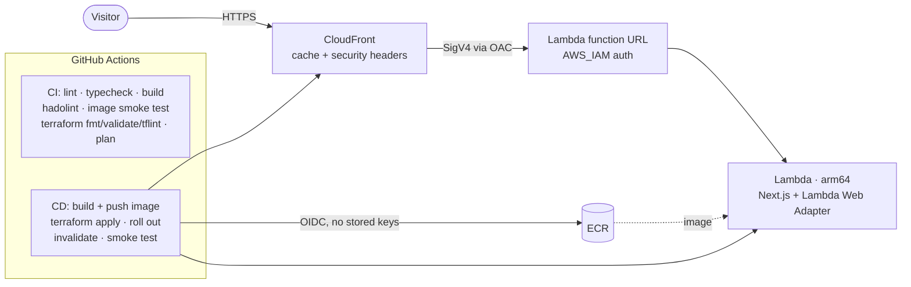

# portfolio

My personal site: a Next.js app packaged as a container image, served from
AWS Lambda behind CloudFront, provisioned with Terraform and shipped by
GitHub Actions.



## Repository layout

| Path               | What it is                                                                  |
| ------------------ | --------------------------------------------------------------------------- |
| `web/`             | Next.js 16 / React 19 / Tailwind 4 app and its `Dockerfile`                |
| `infra/bootstrap/` | One-time account setup: state bucket, ECR, GitHub OIDC roles, Lambda role  |
| `infra/app/`       | The running site: Lambda, function URL, CloudFront (managed by CD)         |
| `.github/`         | CI/CD workflows and Dependabot                                              |

## Local development

Requires Node 22+ and pnpm (via [Corepack](https://nodejs.org/api/corepack.html)).

```bash
cd web
corepack pnpm install
corepack pnpm dev        # http://localhost:3000
```

Other scripts: `pnpm lint`, `pnpm typecheck`, `pnpm build`.

Site content (work history, skills, certifications) lives in
[`web/src/data/resume.tsx`](web/src/data/resume.tsx); blog posts are MDX files in
[`web/content/`](web/content).

### Run the production container

```bash
docker build -t portfolio web
docker run --rm -p 3000:3000 portfolio
```

The same image runs on Lambda: the
[Lambda Web Adapter](https://github.com/aws/aws-lambda-web-adapter) is installed
as a Lambda extension, so it only activates inside the Lambda runtime.

## Deployment

### How the pipeline works

- **Pull requests** run [`ci.yml`](.github/workflows/ci.yml): ESLint, TypeScript,
  `next build`, hadolint, an arm64 image build with a container smoke test,
  `terraform fmt`/`validate`, tflint, and a `terraform plan` of `infra/app`
  posted to the job summary.
- **Merges to `main`** run [`cd.yml`](.github/workflows/cd.yml): CI again as a
  gate, then in the `production` environment it builds the arm64 image and
  pushes it to ECR (tagged with the commit SHA, deployed by digest), runs
  `terraform apply`, rolls the image out with `aws lambda update-function-code`,
  invalidates CloudFront, and smoke-tests the live URL.

AWS access uses GitHub OIDC with two roles: a read-only **plan** role that only
pull-request jobs can assume, and a **deploy** role that only jobs in the
`production` environment can assume. The deploy role has no IAM write access;
the Lambda execution role is created once by the bootstrap stack.

### First-time setup

Prerequisites: Terraform ≥ 1.11, AWS CLI with admin credentials, `gh` CLI.

1. **Bootstrap the account** (once, from your machine):

   ```bash
   cd infra/bootstrap
   terraform init
   terraform apply -var budget_alert_email=you@example.com
   ```

   Optional: move bootstrap's local state into the bucket it created by
   uncommenting the `backend "s3"` block in `versions.tf` and running
   `terraform init -migrate-state`.

2. **Configure GitHub**: run the commands printed by
   `terraform output -raw github_variables`, then create the `production`
   environment (add yourself as a required reviewer for a manual approval gate):

   ```bash
   gh api -X PUT repos/santiago-torres1/portfolio/environments/production
   ```

3. **Deploy**: merge to `main` or run the CD workflow manually
   (`gh workflow run CD`). The first run creates the Lambda function and the
   CloudFront distribution (allow ~5 minutes for CloudFront). The site URL is
   shown on the workflow run and in `terraform output site_url`.

   The first build doesn't know the CloudFront URL yet, so Open Graph tags fall
   back to localhost until the second deploy (or set the `SITE_URL` repository
   variable).

### Custom domain (optional)

Request an ACM certificate in **us-east-1**, then set `domain_names` and
`acm_certificate_arn` for `infra/app` (for example in a `terraform.tfvars`
committed to the repo) and point DNS at the `cloudfront_domain_name` output.

## Design notes

- **Cost**: Lambda and CloudFront both have always-free tiers that cover a
  personal site many times over. Prerendered pages are cached at the edge until
  the next deploy, so Lambda only runs on cache misses. The remaining costs are
  ECR storage (the lifecycle policy keeps the last 10 images), the state bucket,
  and logs (14-day retention): cents per month. An optional AWS Budgets alert
  guards the account.
- **Caching**: Next.js returns HTML or an RSC payload from the same URL
  depending on request headers, and CloudFront ignores `Vary`, so the cache
  policy keys on those headers. Hashed `/_next/static/*` assets use the managed
  `CachingOptimized` policy.
- **Locked-down origin**: the function URL uses `AWS_IAM` auth and only
  CloudFront (via Origin Access Control, scoped to this distribution) can
  invoke it.
- **Supply chain**: GitHub Actions are pinned to commit SHAs; pnpm enforces a
  minimum release age on dependencies; Dependabot uses a matching cooldown; ECR
  tags are immutable and images are scanned on push.
